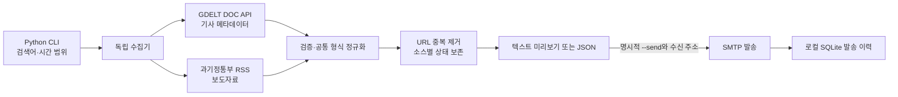

# 반도체·자동화 장비 산업 브리핑

## 프로젝트 목적

반도체와 자동화 장비 산업의 공개 소식 가운데 사용자가 지정한 검색어와 시간 범위에 해당하는 항목을 모아, 출처와 원문 링크가 보존된 브리핑으로 보여주는 프로젝트입니다. 목표는 팀이 아침에 산업 동향을 빠르게 훑고 필요한 원문을 확인하도록 돕는 것입니다.

현재 저장소는 **로컬에서 동작하는 수집·정규화·출력 및 이메일 MVP**입니다. 정기 실행, AI가 작성하는 요약, 운영 DB, 팀 대상 자동 배포까지 완성된 서비스는 아닙니다. 구현 사실과 향후 제안은 아래에서 분리해 설명합니다.

## 현재 구현 아키텍처



- **수집:** GDELT DOC API와 과학기술정보통신부 보도자료 RSS를 각각 호출합니다. 한쪽 실패가 다른 쪽 결과를 버리지 않으며, 출력에 소스별 상태를 표시합니다.
- **선별·정규화:** GDELT 응답은 제목과 HTTP(S) 원문 링크를 검증하고 공통 기사 형식으로 바꿉니다. GDELT의 `seendate`는 관측 시각으로 기록하며 원문 발행 시각으로 간주하지 않습니다. RSS는 항목의 시간·검색어를 적용하고 URL을 검증합니다.
- **권리 처리:** GDELT에서는 기사 본문을 가져오지 않습니다. RSS 설명은 항목 자체에 공공누리 제1유형/KOGL Type 1 표시가 확인된 경우에만 출력용 요약 필드로 사용합니다. 실제 피드의 권리 표시는 추가 검증이 필요할 수 있습니다.
- **결과:** URL 기준으로 중복을 제거한 뒤 텍스트 브리핑 또는 정규화 JSON을 출력합니다. RSS가 제공한 허용 설명을 보여줄 수 있지만, **AI가 생성하는 요약은 아직 없습니다.**
- **이메일:** 기본 동작은 미리보기입니다. 실제 전송은 `--send`, `--to`, 안정적인 `--delivery-id`와 SMTP 환경변수가 모두 명시된 경우에만 시도합니다. SQLite 이력으로 같은 delivery ID의 무분별한 재전송을 막고, 전송 결과가 불명확하면 `unknown`으로 남겨 자동 재전송하지 않습니다. 이 이력은 현재 실행 환경의 로컬 파일이며 공유 운영 DB가 아닙니다.

## 데이터 흐름

1. 실행자가 검색어, 조회 시간(1~72시간), 최대 건수(1~250)를 지정합니다.
2. GDELT와 과기정통부 RSS를 독립적으로 조회합니다. GDELT는 요청한 기간을 검색하고, RSS 항목은 수집기에서 시간 범위와 검색어를 확인합니다.
3. 제목·URL 등 필수 필드를 검증하고 소스별 레코드를 공통 형식으로 정규화합니다. 사용할 수 없는 레코드는 제외 건수로 집계합니다.
4. 원문 URL이 같은 항목을 하나로 합치고, 제한 건수와 소스별 성공·실패를 결과에 남깁니다.
5. 텍스트/JSON을 검토합니다. 이메일 전송을 선택한 경우에만 전송 상태를 기록합니다.

## 데이터 소스

| 소스 | 현재 상태 | 인증 | 용도 및 범위 |
|---|---|---|---|
| [GDELT DOC API](https://gdeltproject.org/data.html) | 연결됨 | API 키 불필요 | 글로벌 뉴스 후보의 제목·출처·관측 시각·링크. 언론사 본문은 수집하지 않음 |
| [과학기술정보통신부 보도자료 RSS](https://www.msit.go.kr/contents/cont.do?mId=173&mPid=147&sCode=user) | 연결됨 | 불필요 | 국내 과학기술·ICT·반도체 관련 공식 보도자료 |
| [산업통상부 보도·참고자료](https://www.motir.go.kr/kor/article/ATCL3f49a5a8c) | 후보 | 불필요 | 산업·공급망·투자 정책. 정확한 RSS 주소를 확인한 뒤 연결 예정 |
| [OpenDART](https://opendart.fss.or.kr/intro/main.do) | 후보 | **인증키 필요** | 기업 공시 보조 자료. 뉴스 피드가 아님. [인증키 신청](https://opendart.fss.or.kr/uss/umt/EgovMberInsertView.do) |
| [NAVER API HUB 검색 API](https://guide.ncloud-docs.com/docs/apihub-overview) | 보류 | **인증정보 필요** | 뉴스 검색 후보. AI 처리·이메일 제공 등 이 프로젝트의 이용 권한을 확인한 뒤 적용. [이용 신청 안내](https://guide.ncloud-docs.com/docs/apihub-application) |

API 키를 발급받았다는 사실만으로 콘텐츠를 AI에 입력하거나 이메일로 재배포할 권리가 생기지는 않습니다. 소스와 항목별 이용조건을 확인한 다음 사용 범위를 정합니다. 네이버 API는 세부 권한 검토가 끝날 때까지 호출하지 않습니다.

## 실행 방법

Python 3.12 이상을 기준으로 합니다. 현재 구현은 표준 라이브러리 중심입니다.

```powershell
# GDELT와 RSS에서 최근 24시간의 검색 결과를 수집해 브리핑 출력
python -m briefing --query '(Infineon OR ASE OR HYUNDAI OR MOBIS)' --hours 24 --limit 25

# 저장소의 샘플 데이터를 오프라인 검증하고 이메일 미리보기 출력
python -m briefing --input tests/fixtures/articles.json --email-check

# 정규화 결과를 JSON으로 출력
python -m briefing --query 'semiconductor OR automation' --json
```

`--input`은 네트워크를 사용하지 않는 오프라인 경로입니다. 이메일 설정은 `.env.example`을 참고해 로컬 `.env`에 구성합니다. 비밀값은 저장소에 올리지 마세요. 실제 이메일 발송 명령은 수신 주소와 delivery ID를 포함하며, 별도 명시 없이 발송되지 않습니다. SMTP 발송 자체는 외부 계정 설정이 필요하고 이 문서 작성 시점에 운영 채널로 검증된 상태가 아닙니다.

## 아직 구현되지 않은 항목

- AI 기반 기사 요약 및 근거 검증
- 산업통상부 RSS 연결, OpenDART 및 네이버 API 적용
- 환율·주가지수 등 시장 지표
- 예약 실행, GitHub Actions 배포, 실행 감시
- Neon/PostgreSQL 등 공유 운영 상태 저장소
- 자동 팀 배포 및 확정된 운영 수신 대상

이 항목들은 제안 또는 후속 과제이며 현재 CLI 실행의 일부가 아닙니다. 향후 설계의 선택지와 미결 조건은 [시스템 아키텍처](docs/system-architecture.md), [일일 실행 기획](docs/cron-job-plan.md), [개발 계획](docs/development-plan.md)에서 확인할 수 있습니다. 오프라인 수집 검증은 [수집 테스트 문서](docs/collection-test.md), 이메일 초안은 [이메일 템플릿](docs/email-template.md)을 참고하세요.
