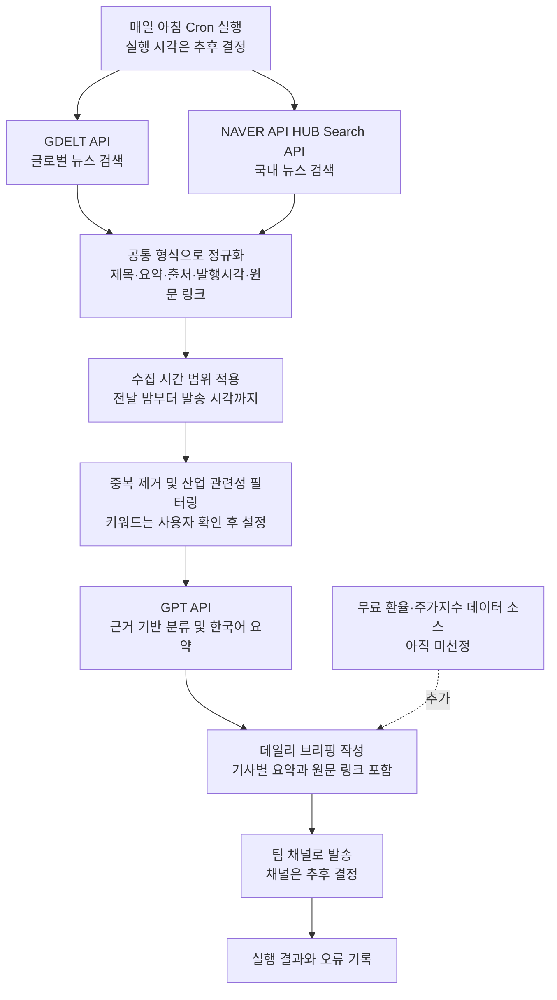

# semiconductor-industry-briefing

매일 아침 전날 밤사이의 반도체·자동화 장비 산업 뉴스를 모아 팀에 전달하는 브리핑 자동화 프로젝트입니다.

## 워크플로우

## 현재 선정된 뉴스 소스

- **GDELT:** 글로벌 뉴스 검색용 API
- **NAVER API HUB Search API:** 국내 뉴스 검색 후보입니다. 공식 안내상 현재 한시적 무료이며 NAVER 검색 카테고리 합산 월 최대 775,000회입니다. 뉴스 API 문서에는 일 25,000회라는 별도 문구가 있어 운영 전 적용 한도를 확인해야 합니다. 검색 결과의 AI 입력을 금지하는 현행 약관 때문에 GPT 브리핑 연결은 보류 중입니다.

## 추후 결정할 항목

- GDELT와 NAVER 검색 키워드: 필터링 설정이 필요해질 때 사용자에게 확인합니다.
- 무료 환율·주가지수 데이터 소스: 별도 선정이 필요합니다.
- Cron 실행 시각과 팀 발송 채널
- 기사 전문 수집·저장 여부와 GPT 입력 범위

GPT 요약에는 수집된 정보만 사용하고, 각 항목에 원문 출처와 링크를 유지합니다.
