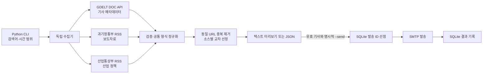

# 반도체·자동화 장비 산업 브리핑

## 프로젝트 목적

반도체와 자동화 장비 산업의 공개 소식 가운데 사용자가 지정한 검색어와 시간 범위에 해당하는 항목을 모아, 출처와 원문 링크가 보존된 브리핑으로 보여주는 프로젝트입니다. 목표는 팀이 아침에 산업 동향을 빠르게 훑고 필요한 원문을 확인하도록 돕는 것입니다.

현재 저장소는 **로컬에서 동작하는 수집·정규화·출력 및 이메일 MVP**입니다. 정기 실행, AI가 작성하는 요약, 운영 DB, 팀 대상 자동 배포까지 완성된 서비스는 아닙니다. 구현 사실과 향후 제안은 아래에서 분리해 설명합니다.

## 현재 구현 아키텍처



- **수집:** GDELT DOC API, 과기정통부 RSS, 산업통상부 RSS를 독립 호출합니다. 한 소스 실패가 다른 결과를 버리지 않으며 소스별 상태·건수를 표시합니다.
- **선별·정규화:** GDELT 응답은 제목과 HTTP(S) 원문 링크를 검증하고 공통 기사 형식으로 바꿉니다. GDELT의 `seendate`는 관측 시각으로 기록하며 원문 발행 시각으로 간주하지 않습니다. RSS는 항목의 시간·검색어를 적용하고 URL을 검증합니다.
- **내용 범위:** 제목·출처·원문 링크와 관측 시각 또는 발행일만 사용합니다. 기사 본문, RSS 설명, AI 요약은 포함하지 않습니다. RSS는 제목에 검색어를 적용합니다.
- **결과:** 정확히 같은 URL을 제거하고 소스별 결과를 번갈아 선정해 제한 건수까지 텍스트 또는 JSON으로 출력합니다. 날짜만 제공된 RSS는 조회 시작일~종료일에 포함되는지 판단하고 `발행일`만 표시합니다. 이 경우 정확한 시간 범위보다 넓게 포함될 수 있습니다.
- **이메일:** 기본 동작은 미리보기입니다. 실제 전송은 `--send`, `--to`, 안정적인 `--delivery-id`와 SMTP 환경변수가 모두 명시된 경우에만 시도합니다. SQLite 이력으로 같은 delivery ID의 무분별한 재전송을 막고, 전송 결과가 불명확하면 `unknown`으로 남겨 자동 재전송하지 않습니다. 이 이력은 현재 실행 환경의 로컬 파일이며 공유 운영 DB가 아닙니다.
- **부분 결과:** 사용자 승인(2026-11-26)에 따라 유효 기사가 1건 이상이면 정상 수집 기사만 보내고 누락 소스·제외 항목 경고를 표시합니다. 전부 실패하거나 유효 기사가 없으면 발송하지 않습니다.

## 데이터 흐름

1. 실행자가 검색어, 조회 시간(1~72시간), 최대 건수(1~250)를 지정합니다.
2. GDELT와 두 부처 RSS를 독립적으로 조회합니다. GDELT는 요청한 기간을 검색하고, RSS 항목은 수집기에서 시간 범위와 검색어를 확인합니다.
3. 제목·URL 등 필수 필드를 검증하고 소스별 레코드를 공통 형식으로 정규화합니다. 사용할 수 없는 레코드는 제외 건수로 집계합니다.
4. 원문 URL이 정확히 같은 항목을 하나로 합친 뒤 소스별로 번갈아 선정합니다. 제한 건수와 소스별 성공·실패를 결과에 남깁니다.
5. 텍스트/JSON을 검토합니다. 이메일 전송을 선택한 경우에만 전송 상태를 기록합니다.

## 데이터 소스

| 소스 | 현재 상태 | 인증 | 용도 및 범위 |
|---|---|---|---|
| [GDELT DOC API](https://gdeltproject.org/data.html) | 연결됨 | API 키 불필요 | 글로벌 뉴스 후보의 제목·출처·관측 시각·링크. 언론사 본문은 수집하지 않음 |
| [과학기술정보통신부 보도자료 RSS](https://www.msit.go.kr/contents/cont.do?mId=173&mPid=147&sCode=user) | 연결됨 | 불필요 | 국내 과학기술·ICT·반도체 관련 공식 보도자료 |
| [산업통상부 보도·참고자료](https://www.motir.go.kr/kor/article/ATCL3f49a5a8c) | 연결됨 | 불필요 | 공식 RSS POST로 제목·링크·날짜 수집. 국내 산업·공급망·투자 정책 |
| [NIST 제조·전자 RSS](https://www.nist.gov/coo/nist-rss-feeds) | 실응답 확인, 후보 | 불필요 | 제조기술·계측·미국 CHIPS 정책. 행사 및 중복 선별 후 연결 예정 |
| [OpenDART](https://opendart.fss.or.kr/intro/main.do) | 후보 | **인증키 필요** | 기업 공시 보조 자료. 뉴스 피드가 아님. [인증키 신청](https://opendart.fss.or.kr/uss/umt/EgovMberInsertView.do) |
| [NAVER API HUB 검색 API](https://guide.ncloud-docs.com/docs/apihub-overview) | 보류 | **인증정보 필요** | 뉴스 검색 후보. AI 처리·이메일 제공 등 이 프로젝트의 이용 권한을 확인한 뒤 적용. [이용 신청 안내](https://guide.ncloud-docs.com/docs/apihub-application) |

API 키를 발급받았다는 사실만으로 콘텐츠를 AI에 입력하거나 이메일로 재배포할 권리가 생기지는 않습니다. 소스와 항목별 이용조건을 확인한 다음 사용 범위를 정합니다. 네이버 API는 세부 권한 검토가 끝날 때까지 호출하지 않습니다.

## 실행 방법

Python 3.12 이상을 기준으로 합니다. 현재 구현은 표준 라이브러리 중심입니다.

```powershell
# GDELT와 RSS에서 최근 24시간의 검색 결과를 수집해 브리핑 출력
python -m briefing --query '(Infineon OR ASE OR HYUNDAI OR MOBIS OR 반도체 OR 장비 OR 자동차)' --hours 24 --limit 25

# 저장소의 샘플 데이터를 오프라인 검증하고 이메일 미리보기 출력
python -m briefing --input tests/fixtures/articles.json --email-check

# 정규화 결과를 JSON으로 출력
python -m briefing --query '(Infineon OR ASE OR HYUNDAI OR MOBIS OR 반도체 OR 장비 OR 자동차)' --json
```

`--input`은 공급자에 접속하지 않는 샘플 입력 경로입니다. 여기에 `--send`를 추가하면 실제 메일이 전송됩니다. 이메일 설정은 `.env.example`을 참고해 로컬 `.env`에 구성합니다. 비밀값은 저장소에 올리지 마세요. 기존 기업명 4개와 국내 검색어 `반도체 OR 장비 OR 자동차`는 사용자가 승인한 테스트 검색어입니다.

2026-11-26 Gmail 앱 비밀번호를 사용한 SMTP 테스트 메일이 `nuguri12@gmail.com` 받은편지함에 도착한 것을 확인했습니다. Gmail API/OAuth 추가 구현은 이 로컬 MVP의 필수 조건이 아닙니다. 실제 뉴스 수집부터 수신까지의 검증 결과는 `project_memories/STATE.md`를 확인하세요.

실제 발송 명령, `.env`, SQLite 이력 보존 규칙은 [수집 테스트 문서](docs/collection-test.md)에 있습니다. 정기 운영 전까지는 같은 폴더·발송 이력 파일을 유지하고, 같은 브리핑 재실행에는 같은 delivery ID를 사용합니다.

## PostgreSQL 연결 준비

`--input <저장 JSON> --store-db`로 정규화 결과를 PostgreSQL에 저장하는 선택 경로와 migration이 구현돼 있습니다. `--email-check`는 DB에 브리핑만 저장하고 발송하지 않습니다. `--store-db --send`는 해당 DB의 발송 이력을 사용하며 DB 오류 시 SQLite로 우회하지 않습니다. Neon 계정이 아직 없어 실접속·SQL 동시성 검증은 미완료입니다. [연결 준비 안내](docs/database-setup.md)를 따르세요.

2026-11-26 산업통상부의 실제 당일 반도체 자료 1건으로 미리보기·SMTP 발송·받은편지함 내용 확인을 완료했습니다. 같은 발송 ID 재실행 후 추가 메일은 없었습니다. GDELT 실패를 명시한 부분 결과이며 전체 뉴스 커버리지나 예약 운영 검증은 아닙니다. [추가 소스 평가](docs/source-review.md)에 근거와 한계를 기록했습니다.

## 아직 구현되지 않은 항목

- AI 기반 기사 요약 및 근거 검증
- OpenDART 및 네이버 API 적용, NIST 자동 수집
- 환율·주가지수 등 시장 지표
- 예약 실행, GitHub Actions 배포, 실행 감시
- Neon 프로젝트 배포·실접속 검증, SQLite 이력 이관, 운영 백업/정리
- 자동 팀 배포 및 확정된 운영 수신 대상

이 항목들은 제안 또는 후속 과제이며 현재 CLI 실행의 일부가 아닙니다. 향후 설계의 선택지와 미결 조건은 [시스템 아키텍처](docs/system-architecture.md), [일일 실행 기획](docs/cron-job-plan.md), [개발 계획](docs/development-plan.md)에서 확인할 수 있습니다. 오프라인 수집 검증은 [수집 테스트 문서](docs/collection-test.md), 이메일 초안은 [이메일 템플릿](docs/email-template.md)을 참고하세요.
