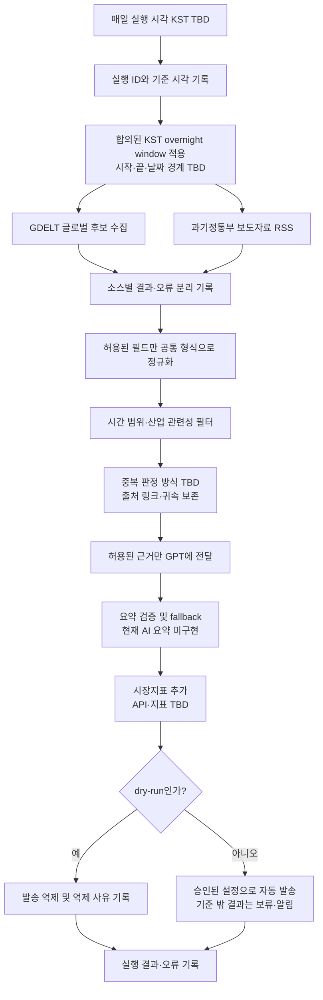

# 데일리 브리핑 Cron Job 기획안

> **현재 MVP 우선 적용(2026-11-26):** 첫 목표는 자료 수집 → 제목·출처·링크·관측 시각 또는 발행일 정규화 → 이메일 작성·SMTP 발송이다. 소스는 GDELT와 MSIT RSS이며, 정확히 같은 URL을 제거한 뒤 소스별로 번갈아 선정한다. 사용자 승인에 따라 정상 기사 1건 이상이면 일부 실패 경고와 함께 발송하고, 전부 실패하거나 기사가 없으면 발송하지 않는다. 검색어는 Infineon·ASE·HYUNDAI·MOBIS와 국내 검증용 반도체·장비·자동차다. 기사 본문·RSS 설명·GPT 요약·시장지표·운영 DB·예약/감시 기능은 이번 MVP에서 제외한다. 아래 상세 운영안과 미결 사항은 **후속 확장안**이며 첫 발송의 선행 조건이 아니다. 현재 동작은 [README](../README.md)와 [실행 안내](collection-test.md)가 우선한다.

**상태: 기획 초안 + 로컬 MVP.** 현재 코드는 GDELT와 과기정통부 보도자료 RSS를 수집하며, 운영 스케줄은 미구현입니다. DeepSearch는 제거했고 NAVER는 세부 권한 확인 전 보류합니다. 이 문서는 향후 운영 방향을 정리하며 미결 값은 **TBD**로 표시합니다.

## 목적과 범위

매일 아침 반도체·자동화 장비 산업의 전날 밤사이 소식을 모아 한국어 브리핑으로 정리하고 팀에 전달하는 것이 목표입니다. 현재 소스는 글로벌 후보 검색용 **GDELT DOC API**와 국내 과학기술·ICT 보도자료용 **과기정통부 RSS**입니다. 두 소스는 독립 수집한 뒤 공통 형식으로 정규화합니다. **산업통상부 RSS**는 게시판과 사용 조건을 확인했지만, 정확한 feed URL을 찾기 전까지 코드에서 호출하지 않습니다.

비용은 무료 공개 소스를 우선합니다. GDELT는 자체 데이터의 이용과 언론사 원문 권리를 구분합니다. RSS 설명문은 개별 항목에서 KOGL 제1유형/Type 1을 확인했을 때만 사용합니다. 네이버 API는 AI 처리·가공·제공 권한을 나중에 별도 확인하며 현재 호출하지 않습니다. 검색어는 실행 시 사용자가 직접 지정합니다.

환율·주가지수도 브리핑 목표에 포함되지만, 시장지표 API, 필요한 환율쌍·지수, 갱신 기준은 **TBD**입니다. 전문 수집·저장·GPT 전달·내부 배포 가능 범위는 공급자 권리 검토 전까지 미정입니다. MVP에는 Recursive Language Models(RLM)가 필요하지 않습니다. 실제 입력량이나 평가 결과에서 한계가 확인되면 재검토합니다.

## 팀 활용과 기대 효과

**업무 활용 가설.** 아침 회의 전에 영업 담당자는 고객사의 설비투자 기사 원문에서 일정을 확인해 미팅 질문을 준비하고, 장비 담당자는 같은 링크에서 관련 공정을 확인할 수 있습니다. 각자 국내외 뉴스를 검색해 링크를 다시 모으던 시간을 줄이고, 회의 시간을 후속 조치 논의에 더 쓸 수 있다는 가설입니다.

**수동 조사 대비 장단점.** 한국어 요약과 출처를 함께 보면 팀원들이 같은 보도를 기준으로 논의를 시작하기 쉽습니다. 반면 두 소스와 승인된 검색어가 포착하지 못한 이슈는 빠질 수 있고, 짧은 요약은 투자 계획과 확정 발주를 혼동할 수 있습니다. 중요한 판단에는 원문 확인 시간이 들며, 비용 비교에는 GPT 호출료와 예외 처리에 쓴 시간도 포함합니다.

**검증 제안.** Dry-run 표본에서 같은 날짜·KST 구간·산업 범위로 만든 수동 목록과 자동 초안을 비교합니다. 회의 자료 준비에 사람이 쓴 시간(원문 확인·수정 포함)과 수동 목록의 중요 기사 중 자동 초안이 놓친 건수를 함께 봅니다. 운영 중에는 기존 실행 기록으로 실행 기록이 남은 운영 건 중 발송을 보류한 비율을 집계하고, 팀원의 확인은 조치가 필요한 예외에 한정합니다.

**MVP와 확장 조건.** MVP에서는 두 뉴스 소스로 아침 브리핑의 활용 가치를 검증합니다. 시장지표는 대상과 제공자·이용 조건을 확정한 뒤 포함합니다. 표본에서 특정 지역이나 매체의 중요 기사 누락이 반복되면 추가 소스를 검토하고, 주간 회의에서 지난 기사 비교 수요가 확인되면 보존·재사용 권리와 추가 비용을 확인한 뒤 주간 요약을 검토합니다.

## 제안 workflow

## 결정 상태 표기

- **확정:** 저장소의 프로젝트 메모에 이미 합의된 내용입니다.
- **제안:** 기술 검토를 위한 기본 후보입니다. 승인되기 전까지 구현 계약이 아닙니다.
- **TBD:** 사용자 또는 구현 담당자가 결정해야 합니다. 아래 결정표에 주체, 필요한 시점, 선택 기준을 적습니다.

기술 스택, 배포 플랫폼, 데이터베이스, 스케줄러, 메시징 API, GPT 모델/SDK는 이 기획안에서 선택하지 않습니다. 개발자는 확정된 제약과 TBD를 바탕으로 대안을 비교하고 별도 설계에서 제안해야 합니다.

현재 요구사항은 스케줄러·저장소·락·전달 방식 등의 구조 대안을 비교하는 설계 초안을 시작하기에는 충분합니다. 확정 설계나 구현 계약에는 아직 부족합니다. 권리와 허용 필드, 키워드·시간 구간·일정·지표·채널, 부분 발송·중복·멱등성 정책, 실행 규모·비용, 배포·접근통제·보존 조건은 임의로 채우지 말고 조건부 대안으로 다뤄야 합니다.

## 기능 요구사항 및 데이터 계약 초안

아래 필드 목록은 공급자별 응답을 그대로 저장하거나 전달하라는 뜻이 아닙니다. 약관상 허용된 값만 취급하며, 권리 확인 전 전문·요약문 필드는 비워 두거나 처리 대상에서 제외합니다. 실제 직렬화 형식과 저장 여부는 구현 설계에서 선택합니다.

| 경계 | 입력 | 처리/출력 계약 |
|---|---|---|
| 실행 → 수집기 | `run_id`, 실행 기준 시각, 합의된 KST `window_start`/`window_end`, 소스별 설정 참조 | 소스별 수집 결과. 공급자별 응답 파싱은 소스 어댑터 내부에 한정하고 자격 증명은 데이터 페이로드와 분리합니다. 구간 경계 포함 규칙은 TBD입니다. |
| 소스 어댑터 → 공통 파이프라인 | GDELT 또는 과기정통부 RSS 응답 | `source`, `title`, `publisher`, 발행/관측 시각, 원문 URL, 항목 권리표시가 허용하는 경우의 snippet. GDELT는 기사 본문을 수집하지 않습니다. 소스 결과에는 성공/빈 성공/실패 상태와 결과 수가 포함됩니다. 원문 전체 payload는 보존하지 않습니다. |
| 정규화 → 선별 | 공통 기사 레코드 및 사용자 승인 필터 설정 | 시간 범위와 관련성 필터를 적용한 기사 ID 목록, 제외/보류 사유와 단계별 건수. 판정은 재현 가능해야 하며 GPT가 시간·출처·수집 사실을 바꾸지 않습니다. |
| 중복 후보 → 요약 | 선별 기사와 중복 후보 그룹 | 기준 승인 전에는 후보 그룹 ID와 구성 기사 ID만 출력하며 자동 병합이나 대표 선택을 하지 않습니다. 기준 승인 후 적용하는 경우에도 모든 원본 링크·출처 귀속을 보존하고, 대표 기사 ID는 그때 산출합니다. |
| GPT → 검증기 | 권리 확인된 제한 입력: 기사 ID, 제목, 출처, 발행 시각, 허용된 텍스트와 원문 링크 | 기사별 `article_id`, 분류/주제(승인된 분류 체계가 있으면 그 값), 한국어 요약, 근거로 참조한 입력 기사 ID/필드, 불확실성 또는 누락 표시. 모델은 새 URL·수치·사실을 만들지 않으며, 출력 검증은 참조 ID가 입력과 일치하는지 확인합니다. 분류 체계·길이·전달 필드는 TBD입니다. |
| 검증기 → 브리핑 | 검증된 기사 결과, 출처 링크, 시장지표 결과 또는 명시적 미수집/실패 상태 | 문서 수준 실행 기준 시각·적용 구간, 기사별 제목·요약·출처·발행 시각·원문 링크, 부분 결과 경고, 시장지표별 값·통화/단위·출처·as-of 시각. 필수/선택 섹션과 표시 형식은 TBD입니다. |
| 브리핑 → 전달/감사 | 검증된 브리핑과 실행 상태 | 전달 결과, 수신 대상 참조, 공급자 메시지 ID(제공 시)를 실행 기록에 연결해 재시도와 중복 전송을 점검합니다. 저장 기간은 TBD이며 dry-run 동작은 dry-run 절을 따릅니다. |

### 선별·정렬·요약 요구

- **선별:** 현재 구현 소스는 GDELT(글로벌 발견)와 과기정통부 보도자료 RSS(국내 정책·R&D)입니다. 산업통상부 RSS와 OpenDART는 추가 후보이며, OpenDART는 기사 대신 기업 공시를 보완합니다. NAVER 검색 API는 사용 권한 확인까지 보류합니다. 실행 시 키워드는 사용자 입력이며 시간·산업 관련성 판정은 결정적으로 수행합니다.
- **정렬 제안:** 기본 검토안은 발행 시각 최신순이며, 동률 시 안정적인 기사 ID 또는 URL 기준으로 순서를 고정하는 것입니다. relevance 점수 우선 정렬, 카테고리 묶음, 시간순 중 무엇을 사용자 화면의 기본으로 할지는 TBD입니다. 점수는 GPT 생성값을 사실 점수처럼 취급하지 않습니다.
- **요약 형식 제안:** 기사별로 제목, 짧은 한국어 요약, 출처, 발행 시각, 원문 링크, 입력 근거 참조를 구조적으로 반환하고 검증 후 템플릿으로 렌더링합니다. 요약 길이, 분류 항목, 근거 표시 방식은 사용자/기획 담당자가 품질·가독성 기준으로 결정합니다.
- **근거성:** 요약에 사용한 기사 ID는 수집된 입력 ID 집합에 속해야 합니다. 허용된 기사 텍스트가 없으면 그 텍스트를 요약 근거로 가장하지 않습니다. GPT 불능/오류 시 제목·링크 등 권리 확인된 metadata만 쓰는 결정적 fallback 후보를 사용하고, 그것도 불가하면 발송을 억제합니다.

### 시간·누락·중복 계약

- 시간은 KST 기준으로 처리하되, 공급자 발행 timestamp의 원래 offset과 원시값을 가능한 범위에서 보존하고 비교용 시각을 명시합니다. UTC/KST 변환 오류를 막기 위해 timezone-naive 값의 취급, 경계 포함 여부, 시작·종료와 날짜 규칙은 TBD입니다.
- 발행 시각이 없거나 파싱 불가한 기사는 자동 선별에서 보류하고 별도 건수로 보고하는 방안을 제안합니다. 포함/제외 선택은 사용자와 구현 담당자가 정확성 대 누락률 기준으로 결정합니다.
- 기사 필드 누락은 null과 상태로 표현하고 임의 기본값으로 채우지 않습니다. 제목 또는 원문 링크가 없을 때의 사용 가능 여부는 TBD입니다. 시장지표 누락은 값·시각을 만들어내지 않고 누락/오류로 표시합니다.
- 중복 판정 후보: (1) 완전 일치 URL, (2) 추적 파라미터 등을 정리한 URL, (3) 제목·출처·시간 조합. 넓은 정규화는 서로 다른 기사 병합 위험, 좁은 정규화는 중복 노출 위험이 있으므로 사용자/구현 담당자가 오탐·누락 수용도와 출처 약관을 기준으로 정합니다. 정확한 규칙 전에는 후보 결과를 비교 검토하고 자동 병합하지 않습니다.

## 부분 결과 및 전달 정책 후보

한 소스 실패 시 다른 소스를 계속 수집한다는 것은 확정된 설계 원칙입니다. 다만 결과를 팀에 보낼지는 미정입니다.

| 후보 | 동작 | 장점 / 위험 |
|---|---|---|
| A. 발송 보류 | 필수 소스 중 하나라도 실패하면 생성 결과를 내부 검토용으로만 남기고 외부 발송 억제 | 누락 브리핑 오인 위험이 낮지만 일일 브리핑을 놓칠 수 있음 |
| B. 부분 발송 | 성공한 소스 결과만 전달하고 실패 소스·시장지표 누락을 제목/본문에 명시 | 적시성은 높지만 수신자가 부분성을 놓칠 수 있고, 어떤 소스를 필수로 볼지 정해야 함 |
| C. 검토 대기 | 생성은 하되 자동 발송하지 않고 담당자 검토 후 수동 승인 | 통제력이 높지만 운영 부담과 전달 지연이 생김 |

**제안:** 정책이 결정되기 전에는 외부 발송을 보류하고 이유를 run 기록에 남깁니다. 소스 필수성, 지연 허용치, 담당자 대응 가능성으로 사용자가 후보를 결정해야 합니다. GPT 오류 시의 fallback과 소스 부분 실패 정책은 서로 다른 조건으로 판정합니다.

## 실행 규모, 비용 및 스택 선택 기준

- 일일 실행 주기 외에 소스별 호출 수, 페이지/결과 수, 응답 크기, 재시도, 처리 기사 수, GPT 토큰/호출량을 운영 전 측정하거나 상한을 정해야 합니다. 실제 하루 기사량과 원하는 완료 시간은 TBD이며 임의 수치를 가정하지 않습니다.
- 무료 우선은 뉴스와 시장 데이터 소스 선택 기준입니다. 공급자별 무료 요금/쿼터/약관은 각각 확인하고, 쿼터 초과 시 중단·축소·대체 동작을 결정합니다. GPT API와 팀 전달 API의 과금·쿼터도 별도 비용 항목으로 추정해야 합니다. 모델 선택·요금제·일일 예산은 TBD입니다.
- 호출 비용/지연은 bounded page size, 제한적 retry, GPT 입력 필드·기사 수·응답 길이 제한으로 통제하는 방향을 제안합니다. 구체 상한과 동시성은 측정된 입력량, 시간 목표, 공급자 제한, 예상 비용으로 결정합니다.
- 구현 구조는 얇은 단계 경계(스케줄 시작, 독립 source adapter, 정규화/결정적 처리, 요약/검증, 렌더링/전달, run 기록)를 유지합니다. 별도 서비스, 큐, 데이터베이스 등은 이 규모에 필요하다는 근거가 생길 때만 선택합니다.
- 스케줄러/호스팅은 KST 실행, 재시도와 실행 이력, 겹침 방지, 비밀정보 관리, 운영 비용으로 비교합니다. 저장소는 보존·재실행 요구와 기사 권리를 만족하는 최소 방식으로 선택합니다. lock/idempotency는 선택한 플랫폼의 원자성·전달 API 지원·장애 복구 방식으로 비교합니다. 어떤 특정 기술도 본 문서에서 확정하지 않습니다.

## 로그·보존·비밀값 요구

- 실행 로그의 최소 필드: `run_id`, 시작/종료 시각, window, dry-run/운영 모드, 소스별 상태와 건수, 처리 단계 상태, 중복/필터 건수, 요약·시장데이터·전달 결과, 억제/실패 사유 코드, 재실행/멱등성 참조.
- 오류 상세는 운영 진단에 필요한 만큼만 남기며, 키·토큰·Authorization 헤더, 요청에 포함된 기사 전문, GPT 프롬프트 원문을 기본 로그에 기록하지 않습니다. 콘텐츠 진단 로그가 꼭 필요하면 권리·접근통제·마스킹·보존기간을 별도로 승인받습니다.
- 자격 증명은 환경 변수 또는 배포 플랫폼 secret store 같은 비밀 관리 경계에 두고 로그·저장소·브리핑에 노출하지 않습니다. 교체 주기, 접근자, 저장소/플랫폼은 운영 설계에서 결정합니다.
- 기사 payload 및 실행 메타데이터의 저장 여부·기간·삭제 방법은 TBD입니다. 권리 범위와 재실행/감사 필요를 함께 고려하고, 수집 편의를 이유로 전문을 기본 저장하지 않습니다.

## 검증 및 dry-run 통과 기준

- 테스트는 공급자 응답 fixture와 모의 클라이언트를 사용하며 CI가 실 API·유료 호출·실 채널에 의존하지 않게 합니다.
- 필수 시나리오: 정상·빈 응답, 한 소스 timeout/쿼터/잘못된 payload, pagination 경계(해당 API가 제공하는 경우), KST 경계와 timezone/누락 timestamp, 불완전 필드, 중복 후보 오탐·누락, GPT 오류/잘못된 article ID/근거 없는 출력, fallback, 시장지표 누락, 부분 발송 정책 각 분기, 전달 실패 후 재실행, 겹친 run, 비밀정보 마스킹.
- dry-run은 실제 자격 증명·외부 전달 없이 수행 가능한 경로를 우선 사용합니다. 실 API를 연결하는 단계가 필요하면 권리·쿼터 확인 뒤 제한을 정하고 승인받습니다. dry-run은 항상 전달 결과를 억제하고 억제 사실/사유를 기록해야 합니다.
- **통과 기준 제안:** (1) 합의된 window 및 데이터 계약 검증, (2) 오류와 빈 결과를 구별하고 한 소스 실패가 다른 결과를 버리지 않음, (3) 요약 근거 ID 및 모든 원문 링크 검증, (4) 합의된 중복/부분 결과 정책 준수, (5) 재실행·겹침에도 이중 발송 없음, (6) 실패/발송 억제 이유와 run 기록 확인, (7) 비밀값과 금지 콘텐츠가 로그에 없음, (8) 실행 시간·API 호출량·모델 비용이 승인된 목표 안에 있음.
- 필요한 연속 성공 횟수, 관찰 기간, 성능 목표, 비용 한도는 미정입니다. 사용자/운영 담당자가 실제 사용 위험, 일정 허용치, 비용 상한으로 정하며, 수치가 승인되기 전 운영 발송을 켜지 않습니다.

## 실행·장애 처리

- GDELT와 NAVER는 독립 수집합니다. 소스별 timeout을 두고 일시 오류에만 제한적으로 재시도하며, 빈 성공과 오류를 구분합니다. 한 소스의 실패가 다른 소스 결과를 폐기하지 않게 합니다.
- LLM 요약은 현재 미구현입니다. 추후 GPT가 실패하거나 출력 검증에 실패하면 권리 확인된 필드만 쓰는 결정적 fallback을 시도합니다. fallback에 필요한 근거가 없거나 검증도 실패하면 발송을 억제하고 사유를 기록합니다.
- 겹친 실행을 막고 재실행의 중복 발송을 방지해야 합니다. 락/스케줄러, 멱등성 키/전달 이력 방식은 TBD이며, 플랫폼의 원자성·전달 API 기능·장애 복구 기준으로 개발자가 제안합니다.

## 운용 간 사용자 개입 최소화

- **최초 운영 활성화 전:** 사용자가 정책과 권리 검토 결과, 대상 채널, 샘플 브리핑 및 dry-run 결과를 검토하고 운영 발송을 명시적으로 승인합니다. 승인에 필요한 항목은 첫 활성화 gate에서 한 번 확인합니다.
- **활성화 후 정상 실행:** 매일 사용자의 별도 승인을 기다리지 않고 승인된 설정을 자동 적용합니다. 설정과 변경 이력을 버전/실행 기록으로 남기며, 승인된 정책·권리·채널을 자동 추정하거나 바꾸지 않습니다. 승인 대상 설정이 바뀌면 변경 후 운영 전에 다시 검토·승인을 받습니다.
- **예외:** 입력·권리·설정이 없거나 승인된 범위를 벗어나면 자동 보정하거나 발송하지 않고 해당 단계를 보류합니다. 조치가 필요한 예외만 알림 또는 수동 검토로 보내며, 성공한 정상 실행에 대한 별도 알림은 생략합니다. 예외 기준, 알림 채널·수신자, 대응 담당자는 TBD입니다.
- 제한 재시도, GPT fallback 및 검증 실패 시 발송 억제, 중복 발송 방지, 로그에서 콘텐츠·비밀값 최소화는 앞 절의 운영 요구를 따릅니다.

## 구현 및 운영 gate

해당 단계에 필요한 TBD는 구현 전에 결정표에 따라 확정하고, 공급자별 요금·쿼터·권리는 실제 사용 전에 확인합니다. 최초 운영 발송은 dry-run 통과 기준을 만족하고 사용자가 결과와 발송 활성화를 확인한 뒤 켭니다. 이후 정상 실행에는 매회 승인을 요구하지 않습니다.

## 논리 검토 기록

아래는 저장소 문서 간 일관성과 운영 위험을 검토한 결과입니다. 외부 공급자 약관·요금의 사실 여부는 이 문서 검토만으로 확정하지 않았습니다.

| 심각도 | 근거 및 검토 결과 | 문서 반영 / 수정 제안 |
|---|---|---|
| 높음 | `OPEN_ISSUES.md`는 뉴스 필드의 저장·GPT 처리·내부 배포 권리를 미결로 둡니다. API 접근만으로 기사 전문 이용 권리를 추론할 수 없습니다. | 전문 및 GPT 필드를 TBD로 두고, 소스별 약관 검토 전 권리를 가정하지 않도록 명시했습니다. |
| 높음 | `STATE.md`와 `OPEN_ISSUES.md`는 schedule, 팀 채널, 콘텐츠 범위를 미정으로 명시합니다. 이를 확정한 채 자동 발송하면 원치 않는 시간·대상·콘텐츠로 배포될 수 있습니다. | 전부 TBD로 표시하고 dry-run 및 사용자 확인 전 운영 발송을 금지하는 기준을 넣었습니다. |
| 높음 | 부분 수집·모델 검증 실패 시 발송 정책이 없으면 불완전하거나 근거가 약한 브리핑이 정상 결과처럼 보일 수 있습니다. | 부분 발송 정책을 TBD로 명시하고 정책 확정 전 실패/필수 근거 부족 시 발송 억제 및 이유 기록을 제안했습니다. |
| 높음 | 반복 실행, 재시도, 겹친 스케줄은 중복 발송을 만들 수 있습니다. 메모는 겹침 방지를 요구하지만 구현과 재실행 식별 규칙은 정하지 않았습니다. | 겹침 방지와 멱등성 발송 이력을 요구하되 락 방식·키 기준은 TBD로 남겼습니다. |
| 중간 | NAVER의 0원·25,000회 정보는 2026-11-18 메모에 기록된 확인 자료이며 현재 조건이나 GDELT의 무료/쿼터를 보증하지 않습니다. | 과거 확인 자료임을 한정하고 각 공급자의 요금·쿼터 재확인을 명시했습니다. |
| 중간 | 메모는 키워드의 사용자 결정을 요구합니다. 검색어를 임의로 넣으면 뉴스 범위와 누락 편향이 바뀝니다. | 키워드와 관련성 규칙을 사용자 확인 전 미설정으로 명확히 했습니다. |
| 중간 | 시장지표 소스와 필요한 상품이 미정입니다. 출처·갱신 시각 없이 수치만 노출하면 최신성·비교 기준을 오해할 수 있습니다. | API·환율쌍·지수·신선도·누락 정책을 TBD로 표시하고 채택 시 출처와 기준 시각을 요구했습니다. |
| 중간 | 초안의 canonical URL 및 제목·출처 fallback은 유사한 기사 병합/중복 누락 가능성이 있으며 승인된 정책이 아닙니다. | 이를 확정 동작에서 검토 후보로 낮추고, 정규화 방식 TBD와 출처 링크 보존을 명시했습니다. |
| 중간 | 후보 비교만 허용한다는 설명과 대표 기사 ID를 산출한다는 계약이 함께 있으면 승인 전에 자동 대표 선택/병합하는 것으로 오해할 수 있습니다. | 기준 승인 전 출력은 후보 그룹과 구성 기사 ID로 한정하고, 대표 선택은 승인 기준 적용 후로 명확히 했습니다. |
| 중간 | 발행 timestamp의 시간대·정확도와 window 경계 포함 여부가 정해지지 않았습니다. | KST window 시작·끝·날짜 경계 및 발행 시각 없는 자료의 처리를 TBD로 남겼습니다. |
| 낮음 | RLM은 현재 아키텍처에 필요하지 않다고 기록되어 있습니다. MVP에서 이를 필수 구성으로 추가하면 복잡도만 늘 수 있습니다. | MVP 불필요로 유지하고 실제 입력량/평가에서 한계가 확인될 때만 재검토하도록 했습니다. |

## 미결 결정 목록

| TBD | 결정 주체 | 필요한 시점 | 선택 기준 |
|---|---|---|---|
| RSS 설명문을 처리할 항목별 권리표시 판독과 보존 규칙 | 개발자/운영 | RSS 설명을 요약에 넣기 전에 | 원문 항목의 KOGL 표기 확인, 출처·링크 유지 |
| 산업통상부 RSS 정확한 feed URL | 개발자 | 소스 활성화 전에 | 공식 게시판의 RSS 버튼이 가리키는 endpoint 확인 |
| NAVER 검색 API 상세 권한 | 사용자/운영 | 네이버 결과를 사용하기 전에 | 원문 표시, 이메일 전달, 보존 등 의도한 사용 전체의 공식 허용 확인 |
| 검색어와 산업 관련성 규칙 | 사용자 | 운영 검색 구성 전에 | 산업 범위, 누락 허용도, 조회량/쿼터; 임의 키워드 사용 금지 |
| 실행 시각 KST, window 시작·끝, 양 끝 경계, 날짜 규칙, timestamp 누락 처리 | 사용자(업무 구간), 개발자(표현·검증 방식) | 시간 필터 구현 전에 | 원하는 overnight 의미, 공급자 timestamp의 timezone/품질, 경계 테스트 가능성 |
| 공급자별 요금·쿼터·약관 및 수집/저장/GPT/배포 허용 필드 | 운영/개발 담당자가 증빙 확인, 사용자/조직이 사용 범위 승인 | 해당 필드를 수집·보관·전송하거나 운영하기 전에 | 공식 약관/정책, 현재 콘솔 한도, 요청 빈도, 내부 배포 조건; 양 소스 각각 확인 |
| 시장지표 API, 환율쌍·지수, as-of/신선도와 누락 표시 | 사용자(필요 지표), 개발자(공급자 후보) | 지표 통합 설계 전에 | 무료 우선, 필요 상품 범위, 데이터 신선도, API 한도, 출처 표시·사용권 |
| 팀 채널·전달 대상·운영 일정 | 사용자 | 운영 발송 설정 전에 | 수신자/채널 적합성, 접근 권한, KST 일정, 재시도 시 전달 API 특성 |
| 소스 일부 실패/시장지표 누락 시 A 보류·B 부분 발송·C 검토 대기 중 정책 | 사용자/운영 책임자 | 발송 구현 전에 | 누락 뉴스의 위험, 지연 허용치, 필수 소스, 담당자 검토 가능성 |
| 중복 URL 정규화, 제목/출처 비교, 대표 기사·다중 출처 보존 | 개발자 제안, 사용자 승인 | 자동 병합 구현 전에 | 오탐과 중복 노출 사례, 원문 링크/귀속 유지, 후보 fixture 평가 |
| 재실행 멱등성 키, 전달 영수증 사용, 겹침 방지 방식 | 개발자 | 배포/전달 구조 선택 전에 | 플랫폼 원자성, 전달 API의 멱등성 지원, 장애 후 복구, 상태 보존 비용 |
| 공통 레코드와 GPT 입력·출력 필드, 분류 체계, 요약 길이/표시 방식 | 개발자 제안, 사용자/기획 담당자 승인 | GPT·렌더링 구현 전에; 권리 승인 이후 | 공급자 허용 범위, 근거 추적 가능성, 가독성·검증 용이성 |
| 실제 기사량, 완료 시간 목표, API 호출·모델 토큰/비용 한도 | 운영/사용자와 개발자 | 스택·상한 선택 및 운영 전 | 측정된 run과 공급자 제한, 예산, 허용 지연; 숫자 추정 근거 기록 |
| 배포/스케줄러/저장소/secret store/로그 접근·보존·삭제 | 개발자 제안, 운영/조직 승인 | 배포 설계 및 데이터 보관 전에 | KST 실행, 재시도/겹침 제어, 비용, 접근통제, 콘텐츠 권리, 감사 필요 |
| dry-run 연속 성공 횟수·관찰 기간과 성능 목표 | 사용자/운영 책임자 | 운영 발송 활성화 전에 | 오류/중복/부분 결과 관찰, 실제 트래픽 대표성, 일정·비용 허용치 |
| 예외 알림 기준, 알림 채널·수신자, 대응 담당자 | 사용자/운영 책임자 | 운영 발송 활성화 전에 | 조치 가능성, 긴급도, 기존 운영 채널과 담당자 당직 범위 |
