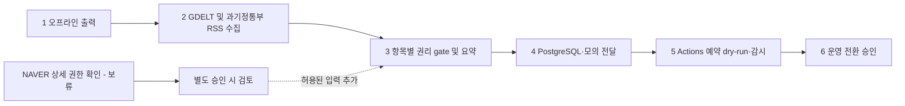

# 데일리 브리핑 개발 계획

> **현재 MVP 우선 적용(2026-11-26):** Python 표준 라이브러리로 GDELT·MSIT RSS를 수집하고 제목·출처·링크·관측 시각 또는 발행일만 정규화해 기존 SMTP와 로컬 SQLite 이력으로 전달한다. RSS 설명·GPT 요약은 사용하지 않는다. 정상 기사 1건 이상이면 일부 실패 경고와 함께 발송하고, 전부 실패하거나 유효 기사가 없으면 발송하지 않는다. 앱 비밀번호로 합성 메일의 Gmail 수신을 확인했으며 실제 뉴스 종단 검증은 `project_memories/STATE.md`를 따른다. 아래 GPT·시장지표·Neon·예약 실행·외부 감시·복구 설계는 **후속 확장안**으로, 로컬 MVP 완료의 선행 조건이 아니다. 현재 동작은 [README](../README.md)와 [실행 안내](collection-test.md)가 우선한다.

상태: 아래 단계는 향후 운영 확장 계획이다. 현재 MVP의 검증 순서는 수집·정규화 회귀 테스트 → 실제 기사 미리보기 → 이메일 수신 → 동일 발송 ID 중복 방지 확인이다. 운영 확장에 관한 미결 사항은 [OPEN_ISSUES](../project_memories/OPEN_ISSUES.md)를 따른다. 아래 제안 경로가 모두 구현되었다는 뜻은 아니다.

## 실행 원칙과 의존 관계

각 단계는 직전 단계의 산출물과 gate를 통과한 다음 시작한다. 합성 데이터와 모의 클라이언트를 우선하고, 실 API·자격 증명·외부 채널은 해당 권리·접속 승인이 준비된 뒤에만 붙인다. 승인된 설정을 자동 사용하며 미결 정책은 기본값으로 추측하지 않는다. 실패 시 다음 단계와 발송을 안전하게 멈춘다.

## 단계별 산출물과 검증

| 단계 | 산출물(제안 경로) | 선행 조건 | 완료 기준 |
|---|---|---|---|
| 1. 오프라인 브리핑 | `briefing/models.py`, `briefing/render.py`, `briefing/__main__.py`, `tests/fixtures/` | 없음. 합성 입력만 | 기사 1건과 빈 입력의 출력에 기준 시각·출처·링크가 있고, 네트워크 및 발송 호출 0건. |
| 2. 글로벌 수집·선별 | `briefing/sources/gdelt.py`, `briefing/select.py` | GDELT metadata 허용 범위 확인; 사용 키워드와 KST 시간 구간은 설정 gate로 두고 값은 TBD | fixture에서 정상/빈/시간초과/잘못된 payload 분리, 시간 경계·누락 시각 검증, 안전한 오류 상태와 다른 소스 결과 보존. |
| 2a. RSS 소스 확장 | 현재 `briefing/__main__.py`의 과기정통부 adapter; 후속으로 산업통상부 RSS | 피드 주소 확인, 항목별 권리 표시 확인, 쿼리·시간 범위 | fixture 기반 RSS/Atom parsing, invalid XML·잘못된 URL·날짜·권리표시 검증. 실호출은 별도 확인 후 수행. |
| 3. 요약·검증·지표 | `briefing/summarize.py`, `briefing/validate.py`, `briefing/market.py` | 기사별 GPT 권리, 모델·비용한도, 지표·제공자 결정 | 틀린 article ID/출처/근거 거부, 허용 필드 fallback, 비용 상한·누락 지표 상태 확인. |
| 4. DB 상태·모의 전달 | `briefing/state.py`, `briefing/delivery.py`, `migrations/` | GitHub runner→PostgreSQL public/private 네트워크 적합성, 리전·비용·계정, 채널 receipt/idempotency 확인; 논리 브리핑 키와 재발송 정책 승인 | migration/runtime 역할 분리, migration version, 유일 제약, 영속 run claim과 발송 CAS, rollback 확인. 동시 선점 승자는 1개다. sending/sent/unknown 덮어쓰기 및 heartbeat 만료만으로 탈취를 차단한다. mock 전달의 sent/fail/unknown에서 성공 건 재전송 없음. DB 상태 기록 불가 시 발송 0건. |
| 5. 예약 dry-run | `.github/workflows/briefing.yml`, config validator, `scripts/check_run.py` | repo/plan 및 기본 브랜치, protected environment/secrets, secret 주입, DB 접속, NAVER 제외 또는 권리 gate 통과, 외부 누락 감시 선택 | `schedule`/`workflow_dispatch`/재실행 경로, dry-run 전달 0건, DB 연결·동시성, secret/content 비노출, 예상 실행 누락과 workflow 실패를 외부 monitor에서 탐지. |
| 6. 운영 전환 | `docs/operations.md`, 복구 절차 및 승인된 운영 설정 | 수신자·예외 담당자·비용/시간한도·dry-run 기간·backup/RPO/RTO 합의. 생성 샘플 및 권리 확인 | 수동 조사와 동일 기간 비교, 준비 시간·중요 기사 누락·비용 기록, backup 복구와 delivery unknown reconciliation 연습. 사용자가 최초 활성화를 승인한 뒤에만 발송 활성화. |

## 배포 구현 상세

무료 인프라를 우선한다. DB는 Neon Free를 권장하며 실제 무료 한도·compute·저장·전송 사용량을 dry-run에서 확인한다. Actions 무료 실행 가능량은 저장소 공개 여부와 계정 플랜으로 확인하고, 감시와 백업도 무료 제공 범위를 선정 기준으로 둔다. 유료 전환은 비용 근거와 사용자 승인을 기록한 뒤 적용한다. GPT API 비용은 인프라와 별도 집계한다. 무료 DB 비교 근거는 시스템 아키텍처의 배포 권장안을 따른다.

권장 토폴로지는 GitHub Actions의 일회성 hosted Ubuntu runner가 Python batch를 실행하고 Neon PostgreSQL pooled TLS endpoint에 TCP 5432로 접속하는 구조다. GDELT, OpenAI 및 승인된 채널은 HTTPS 443으로 호출한다. GitHub runner outbound IP는 동적·공유이므로 고정 IP allowlist를 필수로 하는 DB에서는 이 조합을 쓰지 않는다. 그런 경우 static egress runner, 같은 클라우드의 예약 실행, private networking 중 하나를 비용·운영 부담과 비교해 선택한다. 계정/리전/endpoint는 아직 선정하지 않았다.

예약 `schedule`은 기본 브랜치에 있는 workflow에서만 실행되고 지연·누락될 수 있다. KST 실행시각은 승인 후 표현하며 정각을 피한다. `workflow_dispatch`는 write 권한 운영자가 수동 실행·재실행에 사용하고 기본 입력은 `dry_run=true`다. 수동 재실행은 같은 window의 logical delivery key를 재사용한다. PostgreSQL UNIQUE run key와 영속 소유권, 발송 상태 CAS로 중복을 방어한다. 외부 호출 전 트랜잭션을 커밋한다. 외부 전송 timeout은 `unknown`으로 기록하고 영수증 조회/수동 대조 전 재전송하지 않는다. 이런 상세, DNS/네트워크 연결과 secret 표는 [시스템 아키텍처](system-architecture.md)를 단일 기준으로 삼는다.

실행 누락은 작업 내부에서 알 수 없으므로 외부 monitor가 GitHub Actions 최근 성공을 확인하거나 제한 시간 안 heartbeat를 확인한다. 주기·허용 지연·수신자·monitor 제품은 TBD다. DB 백업/PITR availability와 retention 비용을 선택 플랜에서 확인하고 복원연습을 한다. 중단 시 production send gate를 닫고 schedule/기록을 보존한다. 재개 전 DB, 설정/권리 버전, pending 및 unknown delivery, 외부 메시지 영수증을 대조하며 자동 backfill은 하지 않는다.

## 구현 체크와 운영 지표

- 테스트는 API별 fixture와 mock을 사용하고 CI는 실제 API·비용·팀 채널에 의존하지 않는다.
- HTTP timeout, 크기·페이지·호출·토큰 제한을 두고 transient 오류만 승인된 횟수로 재시도한다. 인증/권리/설정 오류는 즉시 중단한다.
- DB schema 변경은 versioned migration으로 적용한다. 전용 migration role만 DDL 권한을 갖고 app runtime role은 필요한 행 상태 변경만 허용한다. 잠금 트랜잭션은 외부 네트워크 호출 동안 열어두지 않는다.
- 전달 테스트는 성공, 확정 실패, 응답 불명, 프로세스 중단, DB 기록 실패를 다룬다. 외부 idempotency 기능을 확인하지 못하면 exactly-once 전송을 보장한다고 주장하지 않는다.
- 로그에는 run ID, 설정 버전, source/stage 상태와 건수, 소요시간, 비용 집계, 억제 사유만 남기고 secret, 전문, prompt 원문은 남기지 않는다.
- 팀 효과는 수동 조사 대비 자료 준비 시간(원문 검토·수정 포함), 중요 기사 누락, GPT/API 비용, 예외 대응 시간을 기록한다. 실행 기록이 생성된 운영 run 중 보류 비율을 함께 본다. 임계치와 관찰 기간은 사용자·운영 담당자가 정한다.

## 미결 결정

**기술 선택 전 확인:** GitHub 조직/plan·runner network, DB 공급자/리전/비용/pooled endpoint/TLS 제한/backup, public endpoint 수용 여부, monitor, 모델·예산, 실제 quota 및 운영 접근자.

**업무 정책:** 검색어·관련성, schedule/window 경계와 timestamp 누락, 콘텐츠 권리·보존, NAVER 상세 권한(보류), 시장지표·제공자, 채널·수신자, 부분 결과 정책, 중복·logical delivery identity·수동 재발송 조건, 예외 알림, dry-run 기간·통과 기준, 비용·시간 한도. 설계가 필요한 각 단계에서만 질문하고 답 전에는 해당 실연동·발송을 비활성화한다.

## 공식 운영 문서

- GitHub Actions 예약 동작·기본 브랜치·지연: [workflow syntax](https://docs.github.com/en/actions/reference/workflows-and-actions/workflow-syntax), [events](https://docs.github.com/en/actions/reference/workflows-and-actions/events-that-trigger-workflows)
- 수동 실행 및 권한: [manual workflow runs](https://docs.github.com/en/actions/how-tos/manage-workflow-runs/manually-run-a-workflow)
- runner IP 및 네트워크 고려: [GitHub IP addresses](https://docs.github.com/en/authentication/keeping-your-account-and-data-secure/about-githubs-ip-addresses)
- environment secret/protection plan 조건: [deployment environments](https://docs.github.com/en/actions/concepts/workflows-and-actions/deployment-environments), [environment REST API](https://docs.github.com/en/rest/deployments/environments)
- 과기정통부 [RSS 안내](https://www.msit.go.kr/contents/cont.do?mId=173&mPid=147&sCode=user), [저작권 정책](https://msit.go.kr/contents/cont.do?mId=161&mPid=147&sCode=user)
- 산업통상부 [보도·참고자료 RSS 게시판](https://www.motir.go.kr/kor/article/ATCL3f49a5a8c), [저작권 정책](https://www.motir.go.kr/kor/contents/81)
- NAVER API 권한 확인은 추후 별도 작업: [공식 이용약관](https://developers.naver.com/products/intro/terms/terms.md)
- Neon 기능·리전·요금은 실제 선택 플랜 기준으로 [공식 문서](https://neon.tech/docs/introduction)에서 재확인한다.
