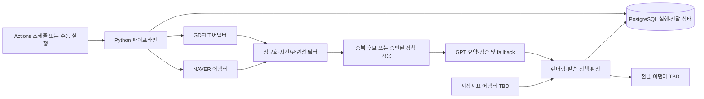

# 데일리 브리핑 시스템 구조 초안

상태: 기술 제안. 사용자 승인된 운영 정책이나 구현 완료를 뜻하지 않는다. 기준 문서는 `cron-job-plan.md`와 `project_memories/`이다.

## 목적과 선택

하루 한 번 글로벌·국내 뉴스를 독립 수집하고, 허용된 근거로 한국어 브리핑을 생성한다. 시장지표와 출처를 표시하고 승인된 팀 채널에 전달한다. 최초 운영 발송 전 dry-run과 사용자 승인이 필요하며, 이후 정상 실행은 승인된 설정으로 자동 처리한다. RLM, 상시 서버, 큐는 MVP 범위에서 제외한다.

팀은 원문 링크와 한국어 요약을 공통 출발점으로 삼아 회의와 고객 대응을 준비한다. 검색·자료 준비 시간 절감은 검증할 가설이며, 누락이나 요약 오류가 있을 수 있으므로 중요한 판단에는 원문 확인이 필요하다. 시장지표는 대상과 제공자·이용 조건을 확정한 뒤 포함한다.

| 구성 | MVP 권장 | 이유 및 전제·제약 |
|---|---|---|
| 실행 코드 | Python 3, 표준 라이브러리와 HTTPX, OpenAI Python SDK | 시간대 처리와 데이터 처리에 적합하다. 구체 버전과 모델은 구현 시 호환성·비용 확인 후 고정한다. |
| 스케줄·실행 | GitHub Actions scheduled workflow 및 수동 실행 | 기존 저장소와 연계하고 별도 상시 서버를 운영하지 않는다. 예약 실행은 지연·누락 가능성이 있어 실행 이력 감시가 필요하다. KST 시각은 승인 후 UTC cron으로 변환한다. |
| 영속 상태 | 관리형 PostgreSQL | 독립 실행 간 원자적 잠금 및 발송 이력 보존이 가능하다. 공급자, 비용, 접근 및 보존은 운영 승인 전 확인한다. Actions 실행 디스크나 artifact만으로 중복 발송을 제어하지 않는다. |
| 비밀값 | GitHub Actions 환경 secrets | 런타임에만 주입하고 최소 권한으로 관리한다. 조직 정책과 외부 DB 접근 가능성이 전제다. |
| 데이터·전달 | GDELT, NAVER Search; GPT API; 시장지표·전달 어댑터 TBD | 초기 뉴스 소스는 기존 결정이다. 시장지표와 팀 채널은 선택하지 않는다. |

대안으로 단일 상시 호스트의 cron과 로컬 SQLite는 작지만 호스트 유지·백업과 장애 복구 책임이 생긴다. 관리형 스케줄러와 작업 실행 서비스는 운영 제어가 풍부하지만 클라우드 계정과 설정이 늘어난다. 권장안은 GitHub 사용과 관리형 DB가 허용되고 일일 처리량·비용이 적절하다는 조건에서 유리하다. 조건이 맞지 않으면 배포 방식을 재선정한다.

## 구성과 흐름

실행기는 run ID, 설정 버전, 기준 시각과 승인된 KST 구간을 기록한다. 소스 어댑터는 공급자별 timeout·일시 오류 재시도, 응답 파싱 및 성공/빈 성공/부분 성공/실패를 분리한다. 공통 레코드는 기사 ID, 출처, 제목, 발행 시각과 상태, 수집 시각, URL, 허용된 텍스트를 가진다. 허용되지 않거나 없는 필드는 처리하지 않는다.

필터는 승인된 구간과 관련성 규칙을 결정적으로 적용한다. 중복 기준 승인 전에는 후보 그룹만 산출하고 자동 병합하지 않는다. 승인 후에도 원본 링크와 귀속을 보존한다. 요약기는 권리 확인된 필드만 GPT에 전달한다. 검증기는 구조, 입력 기사 ID 참조와 링크를 확인한다. 이는 요약의 모든 사실을 증명하지 못하므로 품질 평가가 별도로 필요하다. 실패 시 허용된 필드로 결정적 fallback을 만들고, 근거가 부족하거나 fallback이 실패하면 발송을 억제한다. 시장지표는 값, 단위, 출처, 기준 시각 또는 누락 상태로 전달한다.

## 상태, 겹침 및 전달

PostgreSQL에는 최소한 실행 ID, 논리적 브리핑 식별자, 설정 버전, 시간 구간, 단계별 상태·건수·오류 코드, 전달 상태와 공급자 메시지 ID를 기록한다. 기사 본문과 원본 payload 저장은 권리·보존 승인 전 제외한다. 메타데이터의 보존 기간, 접근자, 삭제 방식도 TBD다.

동일 논리적 브리핑의 실행은 DB의 원자적 잠금으로 겹침을 막고, 전달 이력에는 승인된 식별 기준에 따른 유일 제약을 둔다. Actions concurrency는 보조 수단이다. 잠금 소유자가 종료되면 복구 가능한 방식과 장애 복구 절차를 구현 시 검증한다. 논리적 식별 기준 및 재발송 정책은 TBD다.

전달 상태는 준비, 전송 중, 성공, 확정 실패, 결과 불명으로 구분한다. 전송 직전 상태를 기록하고 성공 응답과 메시지 ID를 저장한다. timeout이나 프로세스 중단으로 수신 여부가 불명인 경우 자동 재전송하지 않고, 전달 API의 조회·멱등성 기능으로 확인하거나 담당자 검토를 기다린다. 외부 API가 원자적 멱등성이나 조회를 제공하지 않으면 이중 발송과 누락을 동시에 완전히 방지할 수 없다.

전달이 확정 실패한 경우 원인과 시도 이력을 기록하고, 재시도 가능한 일시 오류에 한해 승인된 횟수·간격 안에서 재시도한다. 인증·설정 오류나 재시도 한도 초과는 보류하고 담당자 조치를 기다린다. DB에 잠금이나 전달 상태를 안전하게 기록할 수 없으면 발송하지 않는다. 부분 수집이나 시장지표 누락 시 발송 여부는 별도 승인된 정책을 따른다.

## 운영과 보안

승인된 설정에 키워드, 구간, 필수 소스, 부분 실패 정책과 제한값을 보관하고 버전을 실행 기록에 연결한다. 정책 또는 권리 범위를 추측해 변경하지 않는다. 정상 실행은 개별 승인 없이 진행하고, 설정 누락, 필수 근거 부족, 인증 실패, 연속 장애, 예산 초과 또는 전달 결과 불명은 발송을 보류하고 조치 가능한 예외로 기록한다. 예외 알림 채널·대상·기준은 TBD다. 정상 실행의 요약 기록에는 소스별 상태·건수, 처리 결과, 비용 지표와 억제 사유를 남긴다.

승인 대상 설정이 바뀌면 변경 후 운영 전에 다시 검토·승인한다. 정상 성공마다 알리지 않고 조치가 필요한 예외를 승인된 경로로 알린다. 예약 실행 자체가 누락되면 작업 내부에서 알릴 수 없으므로 별도의 실행 이력 감시 수단을 운영 전에 정한다.

요청 수, 결과 수, GPT 입력·출력량과 재시도에 상한을 설정해 비용을 통제한다. 상한과 예산은 측정 및 사용자 결정 전 TBD다. 공급자별 요금·쿼터·약관은 사용 전에 재확인한다. 비밀값은 secrets에서 주입하며 로그에 토큰, 인증 헤더, 기사 전문과 프롬프트 원문을 남기지 않는다. 접근 권한과 보존·삭제 정책은 운영 전에 확정한다.

## 검증 및 활성화

fixture와 모의 클라이언트로 실 API 없이 정상·빈 결과·소스별 실패, 시간대 및 경계, 누락 필드, 중복 후보, GPT 응답 검증과 fallback, 시장지표 누락을 검증한다. DB 통합 검증에서 동시 실행, 잠금 복구, 전달 직전·직후 중단, 불명 상태와 재실행을 확인한다. 발송 어댑터는 모의 채널에서 전달 성공·실패·불명 처리를 검증한다. 로그의 비밀값과 금지 콘텐츠도 확인한다.

dry-run은 외부 발송을 억제하고 이유를 기록한다. 실 API dry-run은 권리·쿼터 확인 및 승인 후 제한적으로 진행한다. 관찰 기간과 연속 성공 횟수, 비용·시간 목표는 TBD다. 운영 발송은 정책·권리·채널 확정, dry-run 기준 충족, 생성 결과 검토와 사용자의 최초 활성화 승인 후에만 켠다.

팀 활용 가설도 같은 날짜·KST 구간·산업 범위의 수동 목록과 dry-run 결과를 비교해 검증한다. 원문 확인과 수정을 포함한 회의 자료 준비 시간, 수동 목록의 중요 기사 중 누락 건수, GPT 비용과 예외 처리 시간을 함께 측정한다. 운영 중 발송 보류 비율은 실행 기록이 남은 운영 건을 분모로 집계한다. 특정 지역·매체의 중요 기사 누락이 반복되면 추가 소스를 검토하고, 주간 요약은 수요와 보존·재사용 권리 및 비용을 확인한 뒤 검토한다.

## 사용자 및 운영 결정 대기

검색 키워드와 관련성 규칙, 스케줄과 overnight window 경계·누락 시각 처리, 시장지표 API 및 지표, 콘텐츠 수집·저장·GPT 처리·배포 권리, 발송 채널과 부분 결과 정책, 기사 중복 및 재발송 멱등성 기준, 예외 알림과 담당자, 실행 규모·비용 상한, 데이터 보존과 dry-run 종료 기준은 모두 TBD다. 기술 선택도 운영 환경과 비용 확인 후 최종 승인한다.
