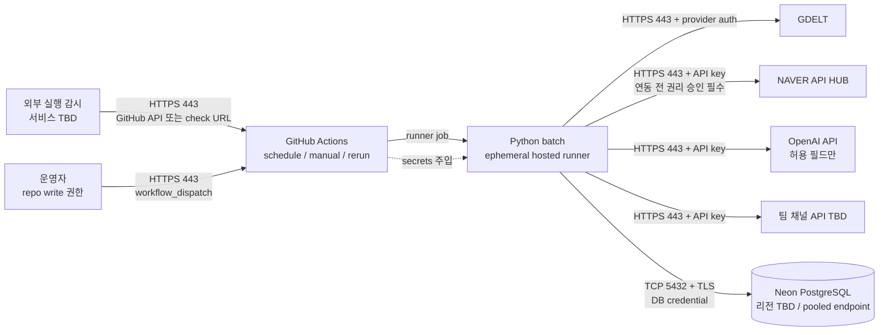
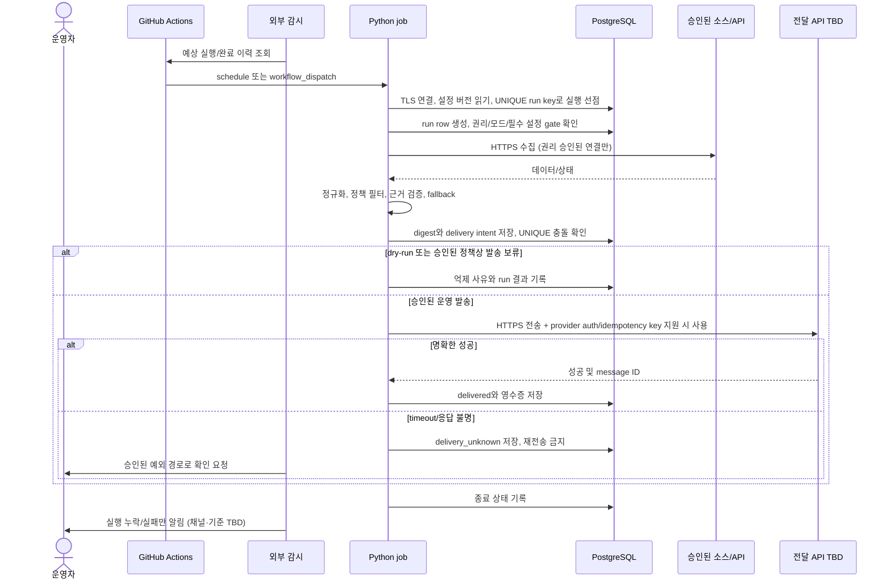

# 데일리 브리핑 시스템 아키텍처

상태: 구현 전 상세 설계 권고안. 서비스 계정, 리전, 예산, 약관 승인 또는 자원 생성은 완료되지 않았다. 업무 정책은 아래 TBD를 유지한다. 기준 문서는 [기획안](cron-job-plan.md), [개발 계획](development-plan.md), `project_memories/`다.

## 목표와 MVP 경계

합성·권리 확인 자료로 오프라인 브리핑을 먼저 완성하고, 이후 소스 수집, 요약, 상태 저장·전달, 예약 dry-run 순으로 확장한다. 정상 운영은 승인된 설정으로 자동 실행한다. 예외만 요약해 대응 담당자에게 보낸다. 상시 서버, 큐, 별도 웹서비스, RLM은 일일 배치 규모에 불필요하다.

팀 활용 가설은 원문 확인·수정 포함 자료 준비 시간과 수동 목록의 중요 기사 누락 건수로 평가한다. 자동 요약은 조사 범위를 좁히는 출발점이며 중요한 영업·투자 판단은 원문을 확인한다. 두 소스·검색어가 놓치는 뉴스가 있을 수 있다. GPT/API 비용 및 예외 처리 시간을 절감 효과와 함께 측정한다.

## 배포 권장안

무료 우선 원칙을 DB·실행·감시 인프라에도 적용한다. DB 권장 요금제는 Neon Free다. 2026-11-20 공식 가격 페이지 확인값은 프로젝트당 월 100 CU-hours와 저장 공간 1 GB이며 카드 없이 시작할 수 있다. 이전 블로그 수치와 달라 실제 생성 시 콘솔 한도를 재확인한다. [Neon 가격](https://neon.com/pricing)

Supabase Free도 PostgreSQL 후보이며 DB 500 MB를 제공한다. 낮은 활동량에 따른 일시 정지와 무료 자동 백업 미포함을 운영 부담으로 고려했다. Cloudflare D1 Free는 일 500만 행 읽기·10만 행 쓰기와 총 5 GB를 제공한다. SQLite 기반 HTTP 접근이므로 현재 psycopg·PostgreSQL 설계의 상태 저장 계층을 변경해야 한다. 이 변경은 충분히 가능하며 무료 한도와 운영 부담을 함께 비교한다. [Supabase 가격](https://supabase.com/pricing), [일시 정지](https://supabase.com/docs/guides/platform/free-project-pausing), [D1 가격](https://developers.cloudflare.com/d1/platform/pricing/), [D1 구조](https://developers.cloudflare.com/d1/)

Neon 추천의 근거는 PostgreSQL 직접 연결과 짧은 일일 배치에 맞는 무료 사용량이다. 실제 사용량은 미측정이다. 예시로 0.25 CU에서 하루 15분 활성화가 30일 지속되면 1.875 CU-hours이며, idle 시간과 추가 작업은 별도 합산한다. 부하 시험에서 실제 compute·저장·전송량을 측정해 무료 한도 안에 드는지 확인한다. 유료 업그레이드와 유료 감시·백업은 사용자 비용 승인 대상으로 둔다. 한도 초과 예상 시 보존량·호출량 조정 또는 다른 무료 구성을 검토한다.

| 구성 | 권장 선택 | 선정 이유와 전제 |
|---|---|---|
| 언어/런타임 | Python 3.12 이상, 표준 라이브러리, HTTPX, psycopg 3, OpenAI 공식 Python SDK | 배치·시간 처리에 적합. 구현 시작 시 지원 버전을 확인하고 lockfile로 고정한다. |
| 스케줄·실행 | GitHub Actions `schedule` + `workflow_dispatch`, GitHub hosted Ubuntu runner | 별도 상시 호스트 없이 저장소에서 예약·수동 실행 및 이력을 관리한다. 기본 브랜치에 workflow가 있어야 한다. 예약은 지연되거나 누락될 수 있어 외부 감시가 필수다. |
| 상태 DB | Neon 관리형 PostgreSQL, pooled TLS endpoint | 짧은 작업이 쓰는 관리형 DB로 단일 VM 운영을 피한다. Neon 선택은 조건부 권고이며 조직 계정·리전·예산·약관을 확인하지 않았다. 영속 실행 선점과 조건부 발송 상태를 활용한다. |
| 전달 | 조직이 승인한 팀 메시징 API 어댑터, 현재 TBD | 플랫폼과 수신 대상 미정. 전송 결과 조회 또는 idempotency 지원 여부가 배포 전 선택 조건이다. |
| 비밀값 | GitHub Actions Environment secrets, 최소 권한 | 런타임에 필요한 값만 job에 노출하고 로그 마스킹을 적용한다. DB는 전용 역할로 제한한다. |
| 누락 감시 | GitHub workflow 실행 이력/실패 알림 + 승인된 외부 uptime/check monitor | workflow 자체가 시작되지 않은 경우 workflow 내부 알림이 불가능하므로 외부 감시가 필요하다. 모니터 서비스/수신자 TBD. |

**네트워크 토폴로지:** Actions runner는 작업 시간 동안만 실행되는 외부 호스트다. DB는 Neon 프로젝트/브랜치의 한 리전에 둔다. GitHub-hosted runner의 outbound IP는 동적·공유이므로 고정 IP allowlist가 필요한 DB 방화벽 구성과 맞지 않는다. MVP는 TLS로 보호된 DB public endpoint와 강한 인증을 사용하되, DB 제공자의 IP 제한 기능이 이를 막으면 다음 중 하나를 다시 선택한다: 고정 outbound IP를 지원하는 GitHub larger runner, DB가 위치한 클라우드의 스케줄 작업, 또는 private networking. self-hosted VM은 운영 부담 때문에 우선하지 않는다. DB public endpoint는 인터넷에서 접근 가능하므로 네트워크 경계 대신 TLS, 비밀값, 역할 권한, 필요 시 공급자 IP 제어로 방어한다. 비밀값 유출 시 영향이 걱정되는 조직 정책이라면 public endpoint를 전제로 진행하지 않는다.

리전은 우선 한국의 업무·지원 위치와 서비스 공급자가 실제 제공하는 리전 중 선택한다. 지원 리전, 데이터 보관 위치, DB/runner/GitHub/LLM 간 왕복 지연, 법무·조직 데이터 위치 규칙, 비용을 비교한다. 특정 서울 리전의 가용성이나 데이터 주권 적합성을 전제하지 않는다. PostgreSQL과 API 연결은 TCP 5432 또는 공급자 connection string 포트, TLS 인증서 검증 필수다. 외부 API는 HTTPS TCP 443이며 각각의 발급 토큰/API key로 인증한다. 임의 inbound 포트는 열지 않는다.

### 배포 구성도

**NAVER-to-GPT 차단 조건:** 현 프로젝트 메모에 따르면 NAVER API HUB Search 약관은 결과를 AI에 입력하거나 가공 결과를 노출·저장·배포하는 것을 제한한다. 따라서 한국 뉴스 NAVER 수집 결과는 현재 설계에서 GPT 입력·가공 브리핑·내부 배포에 연결하지 않는다. 실제 연동 선행 조건은 (a) 의도한 내부 GPT 처리·요약·전달을 명시적으로 허용하는 NAVER의 서면 승인/계약, 또는 (b) 그 사용을 허용하는 대체 한국 뉴스 소스와 권리 검토 및 프로젝트 결정 갱신이다. 권리 확인 없이 메타데이터만 GPT에 넘기는 것도 허용된다고 가정하지 않는다. GDELT discovery metadata 사용 허가가 출판사 기사 전문 이용 권리를 자동 부여하지 않으므로, 기사 본문은 별도 권리 확인 전 입력하지 않는다. 현재 권리 차단을 통과하지 못하면 NAVER 연동 작업을 보류하고 합성 입력/GDELT에서 허용된 metadata만으로 개발한다.

## 트리거와 실행 프로토콜

1. **예약:** GitHub Actions `schedule`이 기본 브랜치의 마지막 커밋으로 실행한다. KST 일정은 승인 후 UTC cron으로 표현하거나 IANA timezone 지원 시 그 기능을 검증해 쓴다. 시간 정각의 과부하를 피하는 분을 고른다. KST overnight window는 런타임 설정의 IANA `Asia/Seoul` 구간으로 계산하며 경계·날짜 정책은 TBD다.
2. **수동 실행:** 기본 브랜치에 둔 `workflow_dispatch`를 GitHub UI에서 운영자(write 권한)만 실행한다. 입력은 `dry_run`(기본 true), 선택적 승인된 business date, 제한된 사유 문자열로 한정한다. 일반 재실행은 신규 발송을 만들지 않도록 기존 logical delivery identity를 재사용한다.
3. **실패 재실행:** 동일 구간의 재실행은 동일 논리적 브리핑 키를 사용한다. 성공 기록이 있으면 발송 단계를 건너뛴다. 결과 불명은 조회/대조 전 재전송 금지다. 재발송은 기존 건을 조정 가능한 담당자가 확인하고 명시적으로 새 재발송 식별자를 승인한 경우에만 허용한다.
4. **동시성:** Actions concurrency group은 실행 중복을 줄이는 1차 방어다. PostgreSQL 영속 실행 선점이 실행 단위의 최종 경합 방지다. 저장소/DB 연결이 안 되거나 lock을 얻지 못하면 발송을 포함한 작업을 fail-closed로 중단한다.

### 실행 시퀀스

## 네트워크·인증·접근 통제

| 연결 | 출발지 → 목적지 | 프로토콜/포트/TLS | 인증·통제 |
|---|---|---|---|
| 트리거 | 운영자 브라우저 → GitHub Actions | HTTPS 443, TLS | GitHub 계정 MFA 및 저장소 write 권한. 운영자 승인군은 조직이 결정한다. |
| 소스 | ephemeral runner → GDELT/NAVER API | HTTPS 443, TLS | 공급자 요건의 API key/OAuth. NAVER는 위 권리 gate 통과 때만. 응답 크기·timeout·호출 상한을 둔다. |
| LLM | runner → OpenAI API | HTTPS 443, TLS | OpenAI API key 또는 지원되는 단기 인증. 권리 허용 필드, 최소 입력, 출력 길이 제한. NAVER 결과 전송 금지 상태 유지. |
| DB | runner → managed PostgreSQL endpoint | TCP 5432, TLS verify-full | 전용 `app_runtime` 계정, 강한 secret, DB 권한 최소화. 공용 hosted runner라 고정 IP를 가정하지 않는다. |
| 전달 | runner → 채널 API TBD | HTTPS 443, TLS | 봇/앱 토큰은 승인된 환경 secret. 수신 대상 제한. idempotency/조회 API 지원 확인. |
| 비밀 주입 | GitHub Environment → runner job | GitHub 내부 secret 제공 | protected environment/branch 조건으로 prod secrets를 제한한다. 수동 workflow 입력에 비밀값을 받지 않는다. |
| 누락 감시 | monitor → GitHub API/check endpoint | HTTPS 443, TLS | read-only GitHub token 또는 비밀 없는 health endpoint; provider 요금·인증 조건 TBD. |

Neon pooled endpoint는 transaction pooling을 사용하므로 영속 claim과 짧은 트랜잭션으로 소유권을 관리한다. 마이그레이션은 별도 direct endpoint를 사용한다. [Neon pooling](https://neon.com/docs/connect/connection-pooling)

## DB 모델과 트랜잭션

PostgreSQL은 실행 상태와 delivery intent/receipt만 영속화한다. 기사 전문·API 원본 payload·GPT prompt/output을 장기 보존하는 저장소로 쓰지 않는다. 허용되는 데이터와 보존기간은 별도 승인 전 기록하지 않는다.

| 테이블 | 최소 컬럼 및 제약 |
|---|---|
| `schema_migrations` | `version` PK, `applied_at`; 배포용 migration role만 기록 |
| `runs` | `run_id` UUID PK, `logical_key` text, `config_version`, `mode`, `window_start/end` timestamptz, `status`, 시작/종료 시각, 단계 상태/건수 JSON(콘텐츠 금지), 오류 코드 |
| `deliveries` | `delivery_id` UUID PK, `logical_key` text UNIQUE, `run_id` FK, `status`, `payload_hash`, `provider_message_id` nullable, 시도 수, 갱신 시각, 안전한 오류 코드 |
| `run_events` (선택) | `event_id` bigserial PK, `run_id` FK, 시각, 단계, 상태, 안전한 요약; 상세 로그는 권리·보존 검토 전 생략 가능 |

logical_key의 구성은 업무 정책으로 결정한다. runs에는 UNIQUE run_key, owner_token, heartbeat_at, status를 둔다. INSERT ON CONFLICT DO NOTHING RETURNING의 반환 행이 있는 작업만 실행한다. heartbeat와 종료 갱신에는 소유자와 현재 상태 조건을 포함한다. 만료만으로 실행을 탈취하지 않는다. 이전 runner 종료와 전달 상태를 대조한 뒤에만 실패 실행의 소유권을 원자적 조건부 갱신(CAS)으로 변경한다.

발송은 UNIQUE logical_key의 prepared 행을 생성하고 prepared에서 sending으로 조건부 UPDATE RETURNING에 성공한 작업만 수행한다. 반환 행이 없으면 보내지 않는다. 기존 sending/sent/unknown을 prepared로 덮어쓰는 upsert는 금지한다. 외부 호출 전에 트랜잭션을 커밋한다. 성공은 sent와 영수증을 기록한다. timeout 또는 sending 중 중단은 unknown으로 대조하며 확인 전 재전송하지 않는다. 확정 실패만 안전한 재시도 조건과 승인된 상한 안에서 동일 키와 새 시도 식별자로 선점한다. DB 기록 실패는 외부 호출 전 중단한다.
별도 migration role은 DDL을 실행하고 runtime role은 필요한 테이블의 SELECT/INSERT/UPDATE만 가진다. 런타임에서 임의 DDL을 실행하지 않는다. migration은 수동 또는 protected 배포 job에서 한 번 적용하며 lock/버전 테이블로 동시 실행을 막는다. DB 계정·비밀값은 분리한다.

## 실패·비용·운영 복구

소스별 timeout과 제한 재시도는 transient 오류에만 적용한다. 빈 결과와 장애는 구분한다. 인증·권리·필수 설정이 해결되지 않으면 소스 호출/GPT 전송/발송을 진행하지 않는다. 한 뉴스 소스 실패가 다른 소스 데이터를 지우지는 않으며 부분 결과 발송은 승인 정책이 있을 때만 한다. NAVER 권리 차단은 수집 오류처럼 재시도할 항목이 아니다.

GPT 오류/검증 실패에는 허용된 입력으로 결정적 fallback을 시도한다. 필수 근거가 없으면 발송을 보류한다. 시장 데이터 선택 전에는 지표를 만들거나 빈 숫자를 채우지 않고 미수집 상태만 표현한다. 호출 수, 페이지 수, 입력 기사 수, 토큰, 재시도와 총 비용에 운영 승인 상한을 둔다. 임계 초과 시 다음 단계/GPT/발송을 중단하고 기록한다. 수치는 측정 후 TBD를 채운다.

**실행 누락 감시:** GitHub `schedule`은 정각 부하에서 지연 또는 드물게 누락될 수 있고 workflow 내 실패 알림은 시작되지 않은 실행을 찾지 못한다. 외부 monitor가 GitHub Actions API의 최근 실행을 주기적으로 확인하거나, 작업이 성공 시 monitor에 heartbeat를 보내 일정 허용 시간 내 없으면 예외 알림을 낸다. monitor 제품, 주기, 시간 허용치, 수신자, 비용은 TBD다. 기본 분 경계를 피해 예약한다.

**백업/복구:** DB 공급자의 자동 백업/PITR 가능 여부, 보존·복구 시점·복구 시간, 비용을 계정 생성 전 공식 문서/플랜에서 확인한다. 사용 전 운영 기록 보존에 필요한 최소 백업을 설정하고 주기적 복구 연습을 계획한다. 백업에 기사 payload는 넣지 않는다. Actions workflow, 설정 및 migrations는 Git 이력에서 복구한다. 복구 후 delivery 상태와 외부 message receipt를 대조하고 `sent`/`unknown`을 재조정하기 전 발송을 재개하지 않는다. 실제 RPO/RTO와 복구 담당자는 TBD다.

**중단/재개:** 긴급 중단은 production environment의 send-enabled 설정/secret을 비활성화하거나 발송 job을 수동 disable하고, reservation schedule과 DB 기록은 유지한다. 수집만 계속할지 전체 중단할지는 운영 선택이다. 재개 전 credential·권리·설정 버전, 마지막 성공 run, pending/unknown delivery, DB 상태와 누락 구간을 대조한다. 미확정 delivery를 처리한 후 운영자가 재개를 승인한다. 대량 자동 backfill이나 새 발송은 하지 않는다.

## 설정과 비밀값

`.env`는 로컬 합성 개발에만 쓰고 저장소에 커밋하지 않는다. GitHub production secrets는 protected environment에 두며 production branch/job에만 노출한다. 비밀이 아닌 정책값은 검토 가능한 YAML/TOML 설정 파일이나 승인된 DB config version으로 관리하고 hash/version을 각 run에 기록한다. 설정 누락·잘못된 값은 기본값으로 고치지 않고 fail-closed한다.

| 변수/설정 키 | 민감도 | 용도 / 제공 조건 |
|---|---|---|
| `APP_ENV`, `DRY_RUN`, `CONFIG_VERSION` | 비밀 아님 | 실행 모드·승인 설정 버전. `DRY_RUN` 기본 true. |
| `DATABASE_URL` | 비밀 | Neon pooled endpoint와 사용자 인증. TLS 검증 포함. runner 전용 secret. |
| `OPENAI_API_KEY` | 비밀 | 허용된 데이터만 전송하는 단계에서 주입. 권리 조건 미충족 시 해당 API 호출 금지. |
| `GDELT_*` 인증/endpoint 설정 | 조건별 | GDELT endpoint는 설정, 인증이 필요하면 secret. endpoint/쿼리는 합의 후 고정. |
| `NAVER_CLIENT_ID`, `NAVER_CLIENT_SECRET` | 비밀 | 발급은 실연동 권리 gate 이후로 제한. 현재는 주입하지 않고 비활성. |
| `MARKET_DATA_*` | TBD | 지표 공급자 확정 전 정의하지 않음. |
| `DELIVERY_API_TOKEN`, `DELIVERY_TARGET_ID` | 비밀/민감 | 채널 승인 후 production environment에만 주입. target은 로그 마스킹. |
| `ALERT_*` | TBD | monitor/예외 수신 경로 승인 뒤 정의. |
| `MAX_*`, `WINDOW_*`, `QUERY_*`, `SEND_ENABLED` | 비밀 아님 | 승인된 제한·키워드·window·발송 gate. config version 통제. |

## 구현 경로와 의존 순서

아래 경로는 제안이며 현재 코드가 있다고 가정하지 않는다. 앞 단계가 통과하지 않으면 뒤 단계로 진행하지 않는다.

| 순서 | 실제 제안 경로/산출물 | 선행 조건 | 완료 검증 |
|---|---|---|---|
| 1 | `briefing/models.py`, `briefing/render.py`, `briefing/__main__.py`, `tests/fixtures/` — 합성 자료 기반 샘플 | 키워드·외부 권리 불필요 | 한 건 및 빈 입력 출력, 링크/기준 시각 필드, 외부 네트워크 0회·발송 호출 0회 |
| 2 | `briefing/sources/gdelt.py`, `briefing/sources/naver.py`, `briefing/select.py` | GDELT metadata 사용 조건 확인; NAVER 실연동은 별도 차단조건 충족; 키워드·window 승인 | mock fixture 정상/빈/timeout/잘못된 payload, 경계/누락 시간, 독립 실패 격리, 중복 후보 자동 병합 없음 |
| 3 | `briefing/summarize.py`, `briefing/validate.py`, `briefing/market.py` | 각 필드의 GPT 이용 권리, 모델·예산, 지표 승인 | 잘못된 기사 ID/근거/URL 거부, fallback, 비용 상한, 시장 누락 상태 |
| 4 | `briefing/state.py`, `briefing/delivery.py`, `migrations/` | PostgreSQL 계정·리전·접속/비용, channel API, logical key 및 partial policy 결정 | DB 통합: concurrent lock, unique conflict, rollback; mock delivery: sent/confirmed fail/unknown 재실행에서 중복 없음 |
| 5 | `.github/workflows/briefing.yml`, 설정 검증기, `scripts/check_run.py` | GitHub plan/repo, protected environment, secrets, DB public/private 경로, 권리·쿼터 확인 | schedule/manual/dry-run 경로, prod secret 분리, event/commit 고정, 외부 monitor 누락 감지, logs에서 secret/content 미노출 |
| 6 | `docs/operations.md`, 운영 체크 및 복구 절차 | 예외 수신자, 시간·비용 목표, backup/RPO/RTO 결정 | 모의 전달, unknown reconciliation 및 복구 연습, 수동 목록 대비 준비 시간·누락 비교, 최초 운영 활성화 승인 |

## TBD 및 선행 승인

**기술적 확인값:** GitHub 조직/plan과 runner 네트워크, Neon 계정·실제 지원 리전·요금·pooler 제한·백업, 외부 monitor, public endpoint 허용 여부, DB 보존/RPO/RTO, 공급자별 현재 호출 제한, API/모델 예산. 특정 계정, 호스트, IP, 리전 또는 계약이 준비됐다고 간주하지 않는다.

**업무 정책 TBD:** 검색 키워드와 관련성, KST 실행 시각과 overnight window 경계·timestamp 누락 처리, 시장지표와 제공자, 부분 결과 규칙, 발송 채널·대상, 콘텐츠 이용 및 보존 권리, URL/제목 중복 기준, 논리 delivery identity와 의도적 재발송 절차, dry-run 성공 기준·관찰 기간, 비용/시간 목표, 예외 알림 수신자·담당자. 이 미결 값 때문에 기술 연결 설계를 비워두지 않는다. 설정 지점과 안전한 기본 동작은 정하되 운영 활성화 전 반드시 값과 승인을 채운다.

## 공식 서비스 문서

- GitHub Actions schedule: UTC/IANA timezone, 기본 브랜치 조건, 지연·누락 주의 [workflow syntax](https://docs.github.com/en/actions/reference/workflows-and-actions/workflow-syntax), [events](https://docs.github.com/en/actions/reference/workflows-and-actions/events-that-trigger-workflows)
- 수동 실행 권한과 기본 브랜치 조건: [manually running a workflow](https://docs.github.com/en/actions/how-tos/manage-workflow-runs/manually-run-a-workflow)
- GitHub-hosted runner 동적 IP 및 allowlist 주의: [GitHub IP addresses](https://docs.github.com/en/authentication/keeping-your-account-and-data-secure/about-githubs-ip-addresses)
- environment secrets 및 protection availability: [deployment environments](https://docs.github.com/en/actions/concepts/workflows-and-actions/deployment-environments), [environment REST API plan notes](https://docs.github.com/en/rest/deployments/environments)
- 임시 클라우드 자격 증명 대안: [GitHub OIDC](https://docs.github.com/en/actions/how-tos/secure-your-work/security-harden-deployments/oidc-in-cloud-providers)
- NAVER 권리 제한과 제한율 충돌: [NAVER 공지](https://www.ncloud.com/support/notice/all/2243), [API HUB overview](https://guide.ncloud-docs.com/docs/apihub-overview), [News API guide](https://api.ncloud-docs.com/docs/naver-api-hub-search-news), [quota spec](https://guide.ncloud-docs.com/docs/apihub-spec)
- GDELT dataset 및 이용 안내: [GDELT about](https://gdeltproject.org/about.html)

Neon의 현재 가격, 리전, pooled endpoint와 TLS/backup 조건은 실제 project 및 선택 플랜에 종속되므로 계정 생성 단계에서 [Neon 공식 문서](https://neon.tech/docs/introduction)로 확인한다. 이 초안은 특정 Neon 기능·가격이나 고정 리전 지원을 보장하지 않는다.
